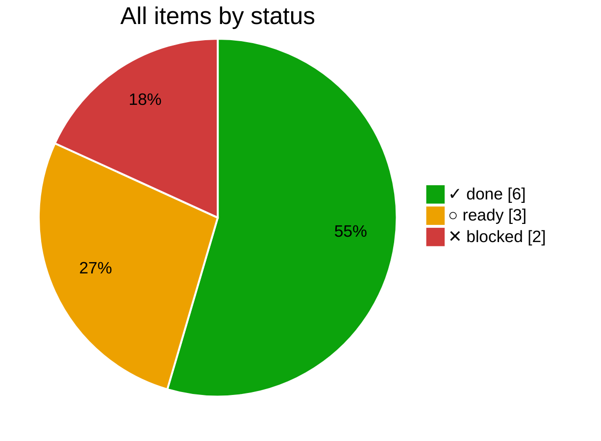
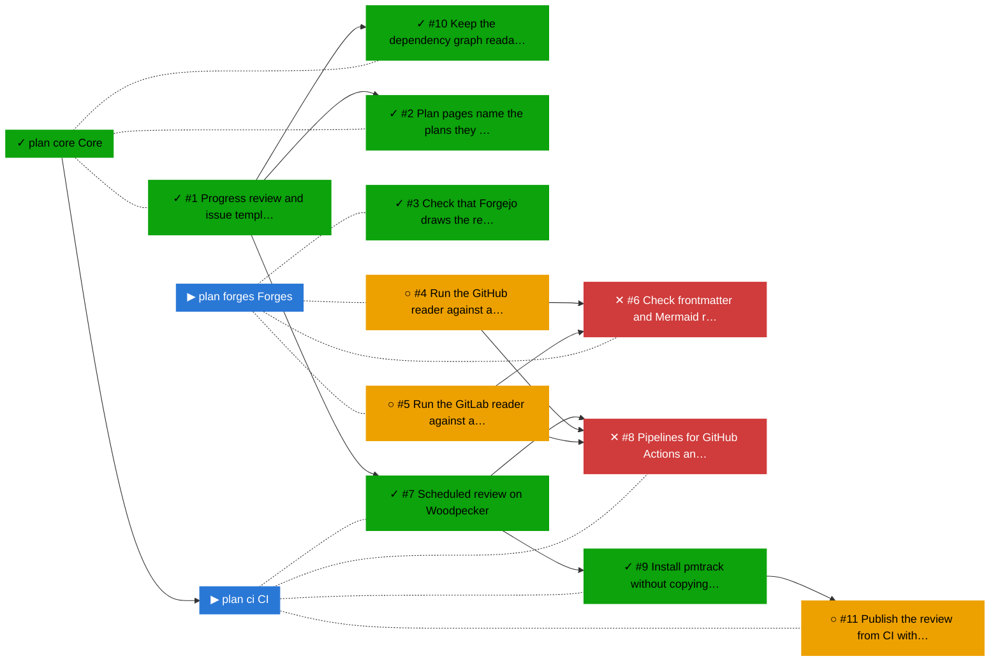

# Progress review

_Data as of 2026-10-22 22:31 UTC · changes compared with 2026-10-22 · generated by pmtrack 0.1.1_

```mermaid
%%{init: {"themeVariables": {"xyChart": {"backgroundColor": "#ffffff", "titleColor": "#222222", "plotColorPalette": "#0ca30c,#ffffff", "xAxisLabelColor": "#222222", "xAxisTitleColor": "#222222", "xAxisTickColor": "#222222", "xAxisLineColor": "#222222", "yAxisLabelColor": "#222222", "yAxisTitleColor": "#222222", "yAxisTickColor": "#222222", "yAxisLineColor": "#222222"}}, "xyChart": {"height": 270}}}%%
xychart-beta horizontal
  title "% done by subset"
  x-axis ["all · 55%", "area/ci · 50%", "area/core · 100%", "area/forges · 25%"]
  y-axis "% done" 0 --> 100
  bar [55, 50, 100, 25]
  bar [0, 0, 0, 0]
```

| Subset | % done | ✓ done | ▶ active | ○ ready | ✕ blocked | Δ % pts |
|---|--:|--:|--:|--:|--:|--:|
| **all** | 55 | 6 | 0 | 3 | 2 | +44 |
| area/ci | 50 | 2 | 0 | 1 | 1 | +50 |
| area/core | 100 | 3 | 0 | 0 | 0 | +50 |
| area/forges | 25 | 1 | 0 | 2 | 1 | +25 |

## Plans

```mermaid
%%{init: {"themeVariables": {"xyChart": {"backgroundColor": "#ffffff", "titleColor": "#222222", "plotColorPalette": "#0ca30c,#ffffff", "xAxisLabelColor": "#222222", "xAxisTitleColor": "#222222", "xAxisTickColor": "#222222", "xAxisLineColor": "#222222", "yAxisLabelColor": "#222222", "yAxisTitleColor": "#222222", "yAxisTickColor": "#222222", "yAxisLineColor": "#222222"}}, "xyChart": {"height": 225}}}%%
xychart-beta horizontal
  title "% done by plan"
  x-axis ["ci · 50%", "core · 100%", "forges · 25%"]
  y-axis "% done" 0 --> 100
  bar [50, 100, 25]
  bar [0, 0, 0]
```

| Plan | % done | ✓ | ▶ | ○ | ✕ | Review |
|---|--:|--:|--:|--:|--:|---|
| ▶ [CI](../docs/ci.md) | 50 | 2 | 0 | 1 | 1 | [ci.md](ci.md) |
| ✓ [Core](../docs/core.md) | 100 | 3 | 0 | 0 | 0 | [core.md](core.md) |
| ▶ [Forges](../docs/forges.md) | 25 | 1 | 0 | 2 | 1 | [forges.md](forges.md) |

## Changes

From 2026-10-22 20:30 to 2026-10-22 22:31 UTC:

- ✓ done: [#2](https://forgejo.lab.bvraghav.com/pm-bot/pmtrack/issues/2) Plan pages name the plans they wait on
- ✓ done: [#3](https://forgejo.lab.bvraghav.com/pm-bot/pmtrack/issues/3) Check that Forgejo draws the review charts
- ✓ done: [#7](https://forgejo.lab.bvraghav.com/pm-bot/pmtrack/issues/7) Scheduled review on Woodpecker
- ✓ done: [#9](https://forgejo.lab.bvraghav.com/pm-bot/pmtrack/issues/9) Install pmtrack without copying the file
- new (done): [#10](https://forgejo.lab.bvraghav.com/pm-bot/pmtrack/issues/10) Keep the dependency graph readable with many items
- new (ready): [#11](https://forgejo.lab.bvraghav.com/pm-bot/pmtrack/issues/11) Publish the review from CI without commits on working branches

## Needs attention

### ✕ Blocked

- [#6](https://forgejo.lab.bvraghav.com/pm-bot/pmtrack/issues/6) Check frontmatter and Mermaid rendering on GitHub and GitLab, waiting on ○ [#4](https://forgejo.lab.bvraghav.com/pm-bot/pmtrack/issues/4) Run the GitHub reader against a live repo, ○ [#5](https://forgejo.lab.bvraghav.com/pm-bot/pmtrack/issues/5) Run the GitLab reader against a live project
- [#8](https://forgejo.lab.bvraghav.com/pm-bot/pmtrack/issues/8) Pipelines for GitHub Actions and GitLab CI, waiting on ○ [#4](https://forgejo.lab.bvraghav.com/pm-bot/pmtrack/issues/4) Run the GitHub reader against a live repo, ○ [#5](https://forgejo.lab.bvraghav.com/pm-bot/pmtrack/issues/5) Run the GitLab reader against a live project

## Next up

_Ready items, those that unblock the most first._

- ○ [#4](https://forgejo.lab.bvraghav.com/pm-bot/pmtrack/issues/4) Run the GitHub reader against a live repo (unblocks 2)
- ○ [#5](https://forgejo.lab.bvraghav.com/pm-bot/pmtrack/issues/5) Run the GitLab reader against a live project (unblocks 2)
- ○ [#11](https://forgejo.lab.bvraghav.com/pm-bot/pmtrack/issues/11) Publish the review from CI without commits on working branches

## Dependency graph

_Legend: ✓ done · ▶ active (assigned or partly ticked) · ○ ready (nothing it waits on is open) · ✕ blocked · arrows point from a dependency to what waits on it; dotted lines join a plan to its items._

## Trend

_The trend starts once there are two days of history._
