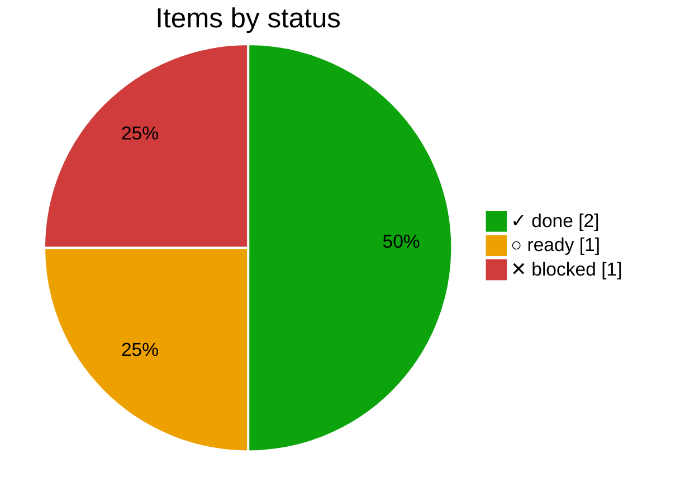
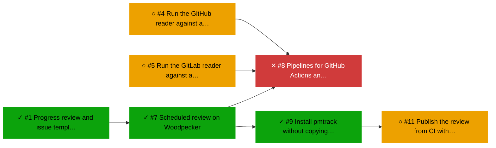

# ▶ CI

_Plan `ci` · [doc](../docs/ci.md) · data as of 2026-10-22 22:31 UTC · [all subsets](README.md)_

**50% done** · ✓ 2 done · ▶ 0 active · ○ 1 ready · ✕ 1 blocked

Depends on: ✓ [Core](../docs/core.md)

| Item | Status | Ticked | Depends on |
|---|---|--:|---|
| [#7](https://forgejo.lab.bvraghav.com/pm-bot/pmtrack/issues/7) Scheduled review on Woodpecker | ✓ done | 3/3 | ✓ #1 |
| [#9](https://forgejo.lab.bvraghav.com/pm-bot/pmtrack/issues/9) Install pmtrack without copying the file | ✓ done | 2/2 | ✓ #7 |
| [#11](https://forgejo.lab.bvraghav.com/pm-bot/pmtrack/issues/11) Publish the review from CI without commits on working branches | ○ ready | 0/3 | ✓ #9 |
| [#8](https://forgejo.lab.bvraghav.com/pm-bot/pmtrack/issues/8) Pipelines for GitHub Actions and GitLab CI | ✕ blocked | 0/2 | ✓ #7, ○ #4, ○ #5 |

## Changes

From 2026-10-22 20:30 to 2026-10-22 22:31 UTC:

- ✓ done: [#7](https://forgejo.lab.bvraghav.com/pm-bot/pmtrack/issues/7) Scheduled review on Woodpecker
- ✓ done: [#9](https://forgejo.lab.bvraghav.com/pm-bot/pmtrack/issues/9) Install pmtrack without copying the file
- new (ready): [#11](https://forgejo.lab.bvraghav.com/pm-bot/pmtrack/issues/11) Publish the review from CI without commits on working branches

## Needs attention

### ✕ Blocked

- [#8](https://forgejo.lab.bvraghav.com/pm-bot/pmtrack/issues/8) Pipelines for GitHub Actions and GitLab CI, waiting on ○ [#4](https://forgejo.lab.bvraghav.com/pm-bot/pmtrack/issues/4) Run the GitHub reader against a live repo, ○ [#5](https://forgejo.lab.bvraghav.com/pm-bot/pmtrack/issues/5) Run the GitLab reader against a live project

## Next up

- ○ [#11](https://forgejo.lab.bvraghav.com/pm-bot/pmtrack/issues/11) Publish the review from CI without commits on working branches

## Dependency graph

_Legend: ✓ done · ▶ active (assigned or partly ticked) · ○ ready (nothing it waits on is open) · ✕ blocked · arrows point from a dependency to what waits on it; dotted lines join a plan to its items._

## Trend

_The trend starts once there are two days of history._
