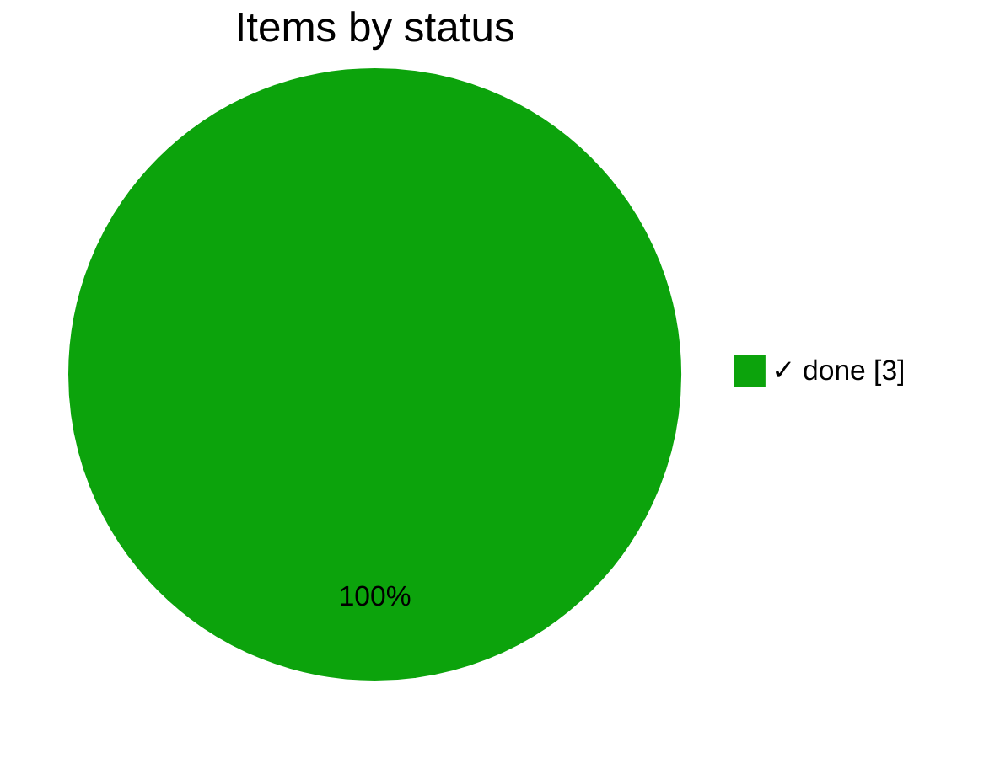
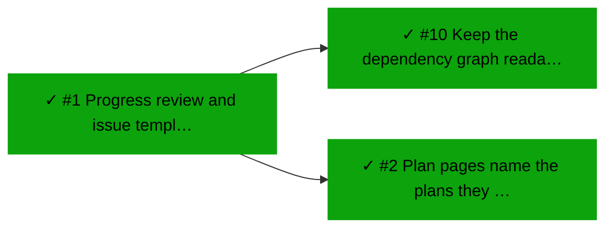

# ✓ Core

_Plan `core` · [doc](https://forgejo.lab.bvraghav.com/pm-bot/pmtrack/src/branch/develop/docs/core.md) · data as of 2026-10-23 04:56 UTC · [all subsets](README.md)_

**100% done** · ✓ 3 done · ▶ 0 active · ○ 0 ready · ✕ 0 blocked

| Item | Status | Ticked | Depends on |
|---|---|--:|---|
| [#1](https://forgejo.lab.bvraghav.com/pm-bot/pmtrack/issues/1) Progress review and issue template generator | ✓ done | 2/2 |  |
| [#10](https://forgejo.lab.bvraghav.com/pm-bot/pmtrack/issues/10) Keep the dependency graph readable with many items | ✓ done | 2/2 | ✓ #1 |
| [#2](https://forgejo.lab.bvraghav.com/pm-bot/pmtrack/issues/2) Plan pages name the plans they wait on | ✓ done | 2/2 | ✓ #1 |

## Changes

From 2026-10-22 20:30 to 2026-10-23 04:56 UTC:

- ✓ done: [#2](https://forgejo.lab.bvraghav.com/pm-bot/pmtrack/issues/2) Plan pages name the plans they wait on
- new (done): [#10](https://forgejo.lab.bvraghav.com/pm-bot/pmtrack/issues/10) Keep the dependency graph readable with many items

## Needs attention

Nothing blocked, stale or malformed.

## Next up

Nothing ready to start.

## Dependency graph

_Legend: ✓ done · ▶ active (assigned or partly ticked) · ○ ready (nothing it waits on is open) · ✕ blocked · arrows point from a dependency to what waits on it; dotted lines join a plan to its items._

## Trend

```mermaid
%%{init: {"themeVariables": {"xyChart": {"backgroundColor": "#ffffff", "titleColor": "#222222", "plotColorPalette": "#0ca30c,#ffffff,#d03b3b,#ffffff,#898781,#2a78d6", "xAxisLabelColor": "#222222", "xAxisTitleColor": "#222222", "xAxisTickColor": "#222222", "xAxisLineColor": "#222222", "yAxisLabelColor": "#222222", "yAxisTitleColor": "#222222", "yAxisTickColor": "#222222", "yAxisLineColor": "#222222"}}, "xyChart": {"height": 360}}}%%
xychart-beta
  title "plan:core: items done and scope"
  x-axis ["10-22 · 3/3", "10-23 · 3/3"]
  y-axis "items" 0 --> 5
  bar [0, 0]
  bar [0, 0]
  bar [0, 0]
  bar [0, 0]
  line [3, 3]
  line [3, 3]
```

_Grey line: items in scope. Blue line: items done, weighted, with partial credit for ticked boxes. Green bars: items done that day. Red bars below 0: items done that were lost that day (reopened, or boxes unticked). A step up in the grey line means scope grew._
