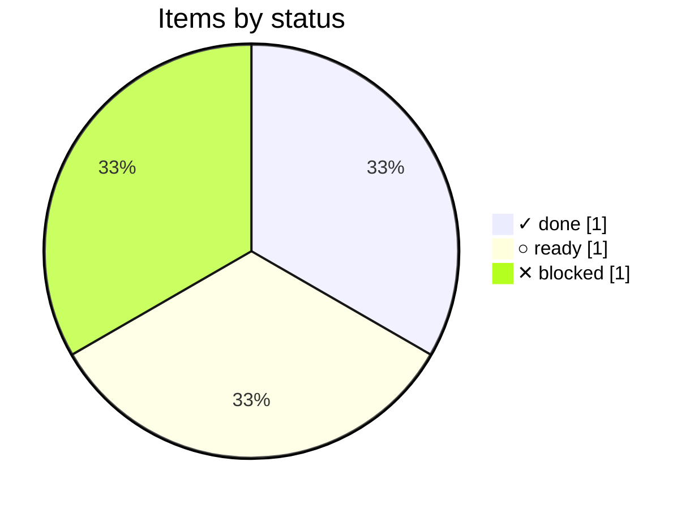

# CI

Issue edits don't trigger CI on any forge, so the review runs on a
schedule and commits `progress/` back. This plan covers the pipelines
and how a project gets pmtrack in the first place.

<!-- pm:progress -->
**33% done** · ✓ 1 done · ▶ 0 active · ○ 1 ready · ✕ 1 blocked · [review](../progress/ci.md)

<!-- /pm:progress -->
