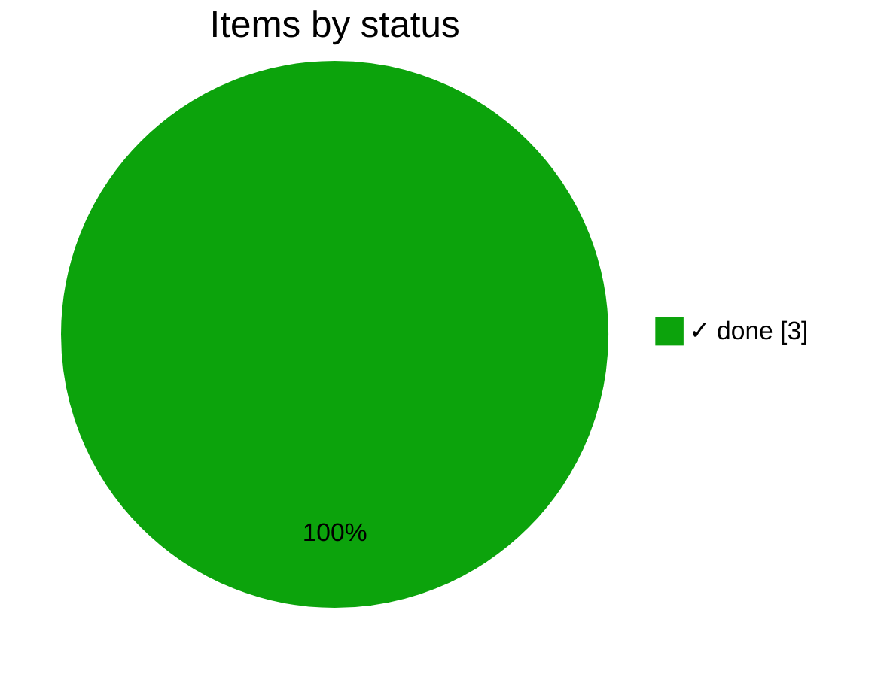

# Core

The frontmatter protocol for issues and plan docs, status and progress
rules, the `review` output and the `templates` generator. See the
[README](../README.md) for the protocol itself.

<!-- pm:progress -->
**100% done** · ✓ 3 done · ▶ 0 active · ○ 0 ready · ✕ 0 blocked · [review](../progress/core.md)

<!-- /pm:progress -->
