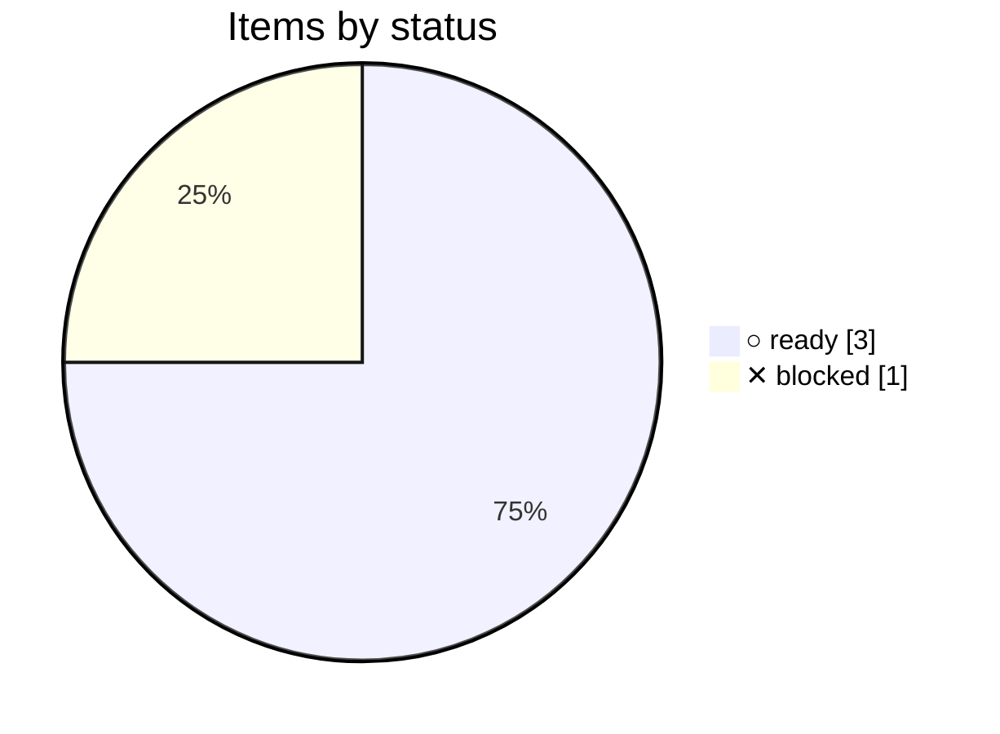

# Forges

pmtrack only uses what all four forges share. This plan checks that
claim on each of them: reading issues through each API, and how each
renders issue frontmatter and the Mermaid charts in the review.

<!-- pm:progress -->
**0% done** · ✓ 0 done · ▶ 0 active · ○ 3 ready · ✕ 1 blocked · [review](../progress/forges.md)

<!-- /pm:progress -->
