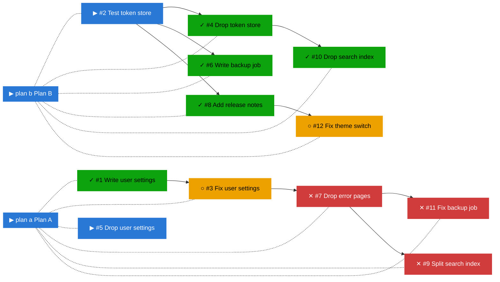
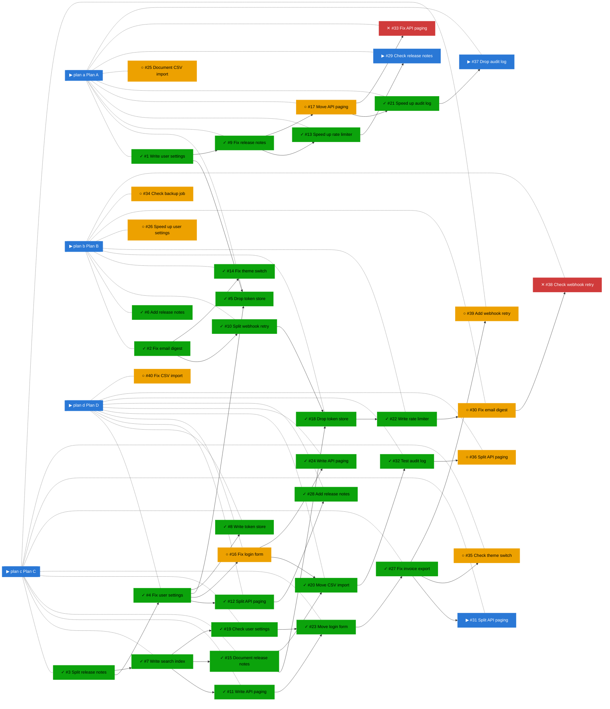

# Graph sample

Dummy projects, to see where the overview graph stops being readable
(issue #10). Generated by `examples/graph_sample.py` with
`pmtrack.mermaid_graph()`, exactly as the review draws it today. Past
`graph_limit` (80) items, done items are left out.

_Legend: ✓ done · ▶ active (assigned or partly ticked) · ○ ready (nothing it waits on is open) · ✕ blocked · arrows point from a dependency to what waits on it; dotted lines join a plan to its items._

## 12 items

About where pmtrack itself is now. 12 items (✓ 5 done · ▶ 2 active · ○ 2 ready · ✕ 3 blocked), 2 plans → **14 nodes, 21 links** drawn, 1,182 characters of Mermaid (Forgejo's limit is 50,000).

## 40 items

A small team's quarter. 40 items (✓ 25 done · ▶ 3 active · ○ 10 ready · ✕ 2 blocked), 4 plans → **44 nodes, 76 links** drawn, 3,148 characters of Mermaid (Forgejo's limit is 50,000).

## 120 items

Past `graph_limit`, so done items are dropped. 120 items (✓ 57 done · ▶ 9 active · ○ 24 ready · ✕ 30 blocked), 6 plans → **93 nodes, 166 links** drawn, 6,542 characters of Mermaid (Forgejo's limit is 50,000).

```mermaid
flowchart LR
  n0["✕ #100 Check API paging"]:::blocked
  n1["✕ #102 Move token store"]:::blocked
  n2["✓ #103 Move user settings"]:::done
  n3["✕ #104 Add theme switch"]:::blocked
  n4["✕ #105 Fix login form"]:::blocked
  n5["▶ #106 Move webhook retry"]:::active
  n6["✕ #107 Move user settings"]:::blocked
  n7["▶ #108 Write token store"]:::active
  n8["○ #109 Document user settings"]:::ready
  n9["✓ #11 Move invoice export"]:::done
  n10["✕ #110 Check audit log"]:::blocked
  n11["✕ #111 Speed up API paging"]:::blocked
  n12["✕ #112 Drop audit log"]:::blocked
  n13["✕ #113 Speed up search index"]:::blocked
  n14["✕ #115 Test email digest"]:::blocked
  n15["✕ #116 Fix email digest"]:::blocked
  n16["▶ #118 Move backup job"]:::active
  n17["✕ #119 Speed up search index"]:::blocked
  n18["○ #120 Split error pages"]:::ready
  n19["✓ #13 Split rate limiter"]:::done
  n20["▶ #14 Test release notes"]:::active
  n21["○ #16 Fix login form"]:::ready
  n22["○ #17 Move API paging"]:::ready
  n23["✓ #18 Drop token store"]:::done
  n24["✓ #20 Move CSV import"]:::done
  n25["✓ #21 Speed up audit log"]:::done
  n26["✓ #23 Move login form"]:::done
  n27["✓ #24 Write API paging"]:::done
  n28["○ #25 Document CSV import"]:::ready
  n29["○ #26 Speed up user settings"]:::ready
  n30["▶ #29 Check release notes"]:::active
  n31["○ #30 Fix email digest"]:::ready
  n32["○ #32 Check backup job"]:::ready
  n33["○ #34 Check backup job"]:::ready
  n34["○ #35 Check theme switch"]:::ready
  n35["○ #37 Check API paging"]:::ready
  n36["✕ #38 Split token store"]:::blocked
  n37["✓ #39 Document release notes"]:::done
  n38["✓ #4 Fix user settings"]:::done
  n39["✕ #41 Document CSV import"]:::blocked
  n40["✕ #43 Write release notes"]:::blocked
  n41["○ #44 Test backup job"]:::ready
  n42["▶ #45 Write user settings"]:::active
  n43["○ #49 Test rate limiter"]:::ready
  n44["✓ #5 Test user settings"]:::done
  n45["✕ #50 Write rate limiter"]:::blocked
  n46["✓ #51 Test backup job"]:::done
  n47["✓ #52 Check search index"]:::done
  n48["✕ #53 Fix webhook retry"]:::blocked
  n49["✓ #54 Test theme switch"]:::done
  n50["✕ #55 Move CSV import"]:::blocked
  n51["✓ #56 Fix user settings"]:::done
  n52["✓ #59 Fix user settings"]:::done
  n53["✕ #60 Speed up backup job"]:::blocked
  n54["○ #63 Fix token store"]:::ready
  n55["✓ #64 Write email digest"]:::done
  n56["✕ #65 Document API paging"]:::blocked
  n57["▶ #66 Add error pages"]:::active
  n58["✓ #67 Fix webhook retry"]:::done
  n59["○ #69 Write invoice export"]:::ready
  n60["○ #70 Document backup job"]:::ready
  n61["✓ #71 Move login form"]:::done
  n62["○ #73 Test search index"]:::ready
  n63["○ #74 Write user settings"]:::ready
  n64["▶ #75 Move user settings"]:::active
  n65["○ #76 Move release notes"]:::ready
  n66["✓ #77 Document login form"]:::done
  n67["✕ #78 Move invoice export"]:::blocked
  n68["✓ #79 Move backup job"]:::done
  n69["✓ #80 Move email digest"]:::done
  n70["✕ #81 Check token store"]:::blocked
  n71["○ #82 Speed up theme switch"]:::ready
  n72["▶ #83 Test error pages"]:::active
  n73["✕ #84 Add email digest"]:::blocked
  n74["○ #86 Check webhook retry"]:::ready
  n75["✕ #87 Test token store"]:::blocked
  n76["○ #88 Move invoice export"]:::ready
  n77["✕ #89 Speed up token store"]:::blocked
  n78["✕ #90 Fix release notes"]:::blocked
  n79["○ #91 Write login form"]:::ready
  n80["✕ #92 Document search index"]:::blocked
  n81["✕ #93 Test invoice export"]:::blocked
  n82["✓ #94 Document token store"]:::done
  n83["○ #95 Check CSV import"]:::ready
  n84["✓ #96 Test search index"]:::done
  n85["✕ #97 Split invoice export"]:::blocked
  n86["✕ #99 Fix email digest"]:::blocked
  n87[["▶ plan a Plan A"]]:::active
  n88[["▶ plan b Plan B"]]:::active
  n89[["▶ plan c Plan C"]]:::active
  n90[["▶ plan d Plan D"]]:::active
  n91[["▶ plan e Plan E"]]:::active
  n92[["▶ plan f Plan F"]]:::active
  n76 --> n0
  n78 --> n1
  n79 --> n2
  n74 --> n3
  n86 --> n4
  n49 --> n6
  n77 --> n6
  n84 --> n7
  n2 --> n8
  n44 --> n9
  n26 --> n10
  n80 --> n10
  n81 --> n11
  n5 --> n12
  n32 --> n13
  n83 --> n13
  n8 --> n14
  n20 --> n15
  n10 --> n15
  n82 --> n16
  n37 --> n17
  n83 --> n17
  n37 --> n18
  n84 --> n18
  n38 --> n21
  n9 --> n22
  n44 --> n26
  n23 --> n27
  n44 --> n30
  n23 --> n31
  n24 --> n32
  n26 --> n34
  n19 --> n35
  n29 --> n36
  n25 --> n37
  n22 --> n39
  n28 --> n40
  n36 --> n40
  n25 --> n42
  n29 --> n45
  n30 --> n48
  n35 --> n50
  n36 --> n51
  n39 --> n52
  n40 --> n53
  n37 --> n54
  n52 --> n54
  n48 --> n56
  n27 --> n57
  n49 --> n57
  n30 --> n58
  n50 --> n58
  n46 --> n59
  n52 --> n61
  n58 --> n62
  n51 --> n63
  n47 --> n65
  n27 --> n66
  n56 --> n66
  n57 --> n67
  n50 --> n68
  n64 --> n70
  n55 --> n71
  n66 --> n72
  n69 --> n72
  n57 --> n73
  n69 --> n74
  n70 --> n75
  n55 --> n76
  n61 --> n77
  n73 --> n77
  n67 --> n78
  n68 --> n79
  n74 --> n80
  n70 --> n81
  n60 --> n82
  n64 --> n84
  n70 --> n85
  n75 --> n86
  n87 -.- n19
  n87 -.- n28
  n87 -.- n35
  n87 -.- n40
  n87 -.- n43
  n87 -.- n50
  n87 -.- n58
  n87 -.- n62
  n87 -.- n68
  n87 -.- n79
  n87 -.- n85
  n87 -.- n2
  n87 -.- n8
  n87 -.- n14
  n88 -.- n20
  n88 -.- n24
  n88 -.- n29
  n88 -.- n32
  n88 -.- n36
  n88 -.- n41
  n88 -.- n45
  n88 -.- n51
  n88 -.- n63
  n88 -.- n69
  n88 -.- n74
  n88 -.- n80
  n88 -.- n3
  n88 -.- n10
  n88 -.- n15
  n89 -.- n25
  n89 -.- n37
  n89 -.- n42
  n89 -.- n46
  n89 -.- n54
  n89 -.- n59
  n89 -.- n64
  n89 -.- n70
  n89 -.- n75
  n89 -.- n81
  n89 -.- n86
  n89 -.- n4
  n89 -.- n11
  n90 -.- n38
  n90 -.- n21
  n90 -.- n33
  n90 -.- n47
  n90 -.- n55
  n90 -.- n60
  n90 -.- n65
  n90 -.- n71
  n90 -.- n76
  n90 -.- n82
  n90 -.- n0
  n90 -.- n5
  n90 -.- n12
  n90 -.- n16
  n91 -.- n44
  n91 -.- n9
  n91 -.- n22
  n91 -.- n26
  n91 -.- n30
  n91 -.- n34
  n91 -.- n39
  n91 -.- n48
  n91 -.- n52
  n91 -.- n56
  n91 -.- n61
  n91 -.- n66
  n91 -.- n72
  n91 -.- n77
  n91 -.- n83
  n91 -.- n6
  n91 -.- n13
  n91 -.- n17
  n92 -.- n23
  n92 -.- n27
  n92 -.- n31
  n92 -.- n49
  n92 -.- n53
  n92 -.- n57
  n92 -.- n67
  n92 -.- n73
  n92 -.- n78
  n92 -.- n84
  n92 -.- n1
  n92 -.- n7
  n92 -.- n18
  classDef done fill:#0ca30c,color:#000,stroke:#0ca30c
  classDef active fill:#2a78d6,color:#fff,stroke:#2a78d6
  classDef ready fill:#eda100,color:#000,stroke:#eda100
  classDef blocked fill:#d03b3b,color:#fff,stroke:#d03b3b
  classDef unknown fill:#898781,color:#000,stroke:#898781
  classDef dropped fill:#898781,color:#000,stroke:#898781
```

