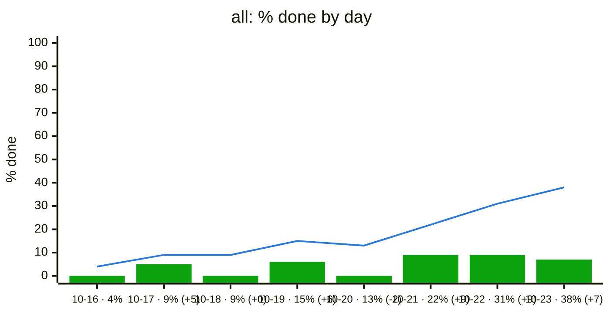
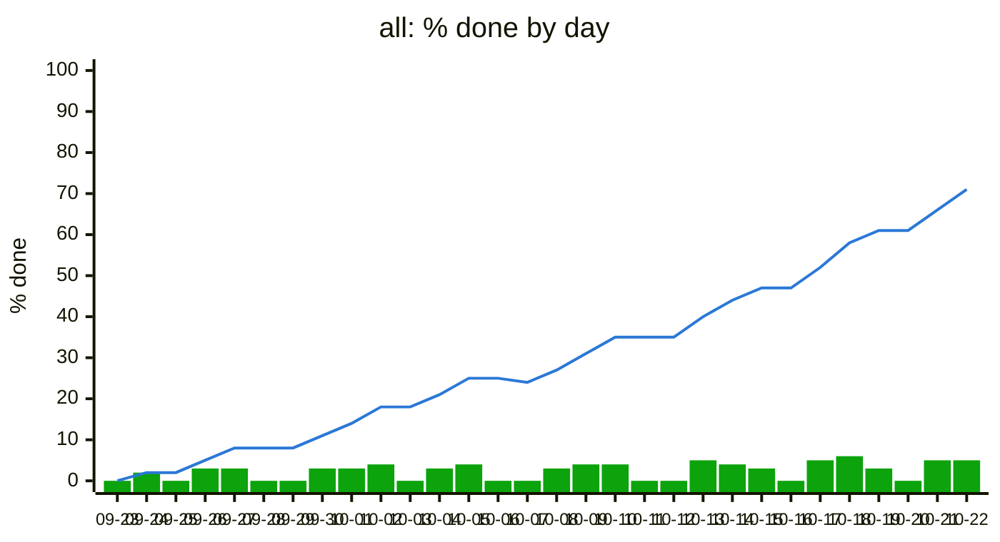
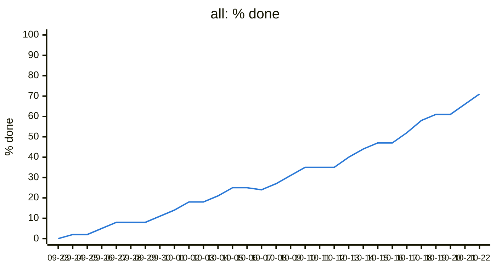

# Trend sample

Made-up data, to check how the trend chart in `progress/` looks once a
project has some history. Generated by `examples/trend_sample.py` with
`pmtrack.trend()`.

## Eight days

Up to ten days, each label carries % done and the change from the day
before. On 10-20 new items came in: % done dipped, so the line drops
and there is no bar that day.

_Line: % done at the end of each day. Bars: % points gained that day. A dip in the line means scope grew or items reopened._

## Thirty days

Past ten days, labels are dates only; read values off the axis.

_Line: % done at the end of each day. Bars: % points gained that day. A dip in the line means scope grew or items reopened._

## One day

With a single day of history the review shows this note instead:

_The trend starts once there are two days of history._

## Option: burn-up with % done

Not in the review yet. % done mixes two things: work finishing and scope
growing. The top chart counts the same thirty days in items, so a dip in
% done shows up as the grey scope line stepping up, not as lost work.
Mermaid allows one y-axis per chart, so % done sits in its own chart
below, on the same days.

_Top, in items: grey line is scope, blue line is items done (weighted, with partial credit), green bars are items finished that day. Bottom: % done, which is blue over grey from the top chart._
