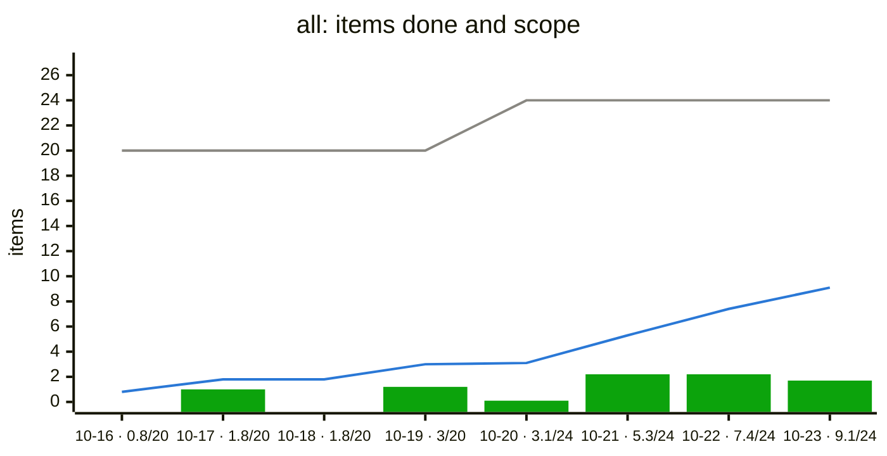
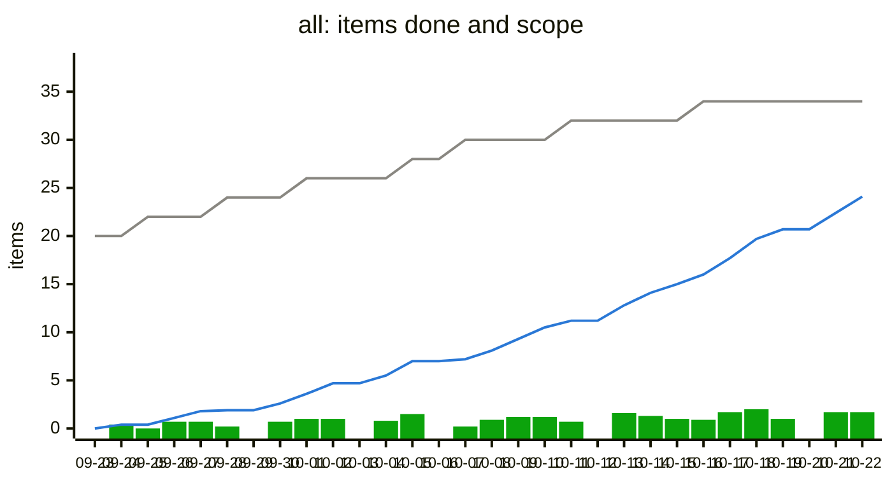

# Trend sample

Made-up data, to check how the trend chart in `progress/` looks once a
project has some history. Generated by `examples/trend_sample.py` with
`pmtrack.trend()`.

The chart is a burn-up in items. % done mixes two things, work finishing
and scope growing; counted in items, scope growth shows as the grey line
stepping up, not as lost work.

## Eight days

Up to ten days, each label carries items done out of scope. On 10-20
four items came in: the grey line steps up and the blue one keeps going.

_Grey line: items in scope. Blue line: items done, weighted, with partial credit for ticked boxes. Bars: items finished that day. A step up in the grey line means scope grew; a dip in the blue one means items reopened._

## Thirty days

Past ten days, labels are dates only; read values off the axis.

_Grey line: items in scope. Blue line: items done, weighted, with partial credit for ticked boxes. Bars: items finished that day. A step up in the grey line means scope grew; a dip in the blue one means items reopened._

## One day

With a single day of history the review shows this note instead:

_The trend starts once there are two days of history._
