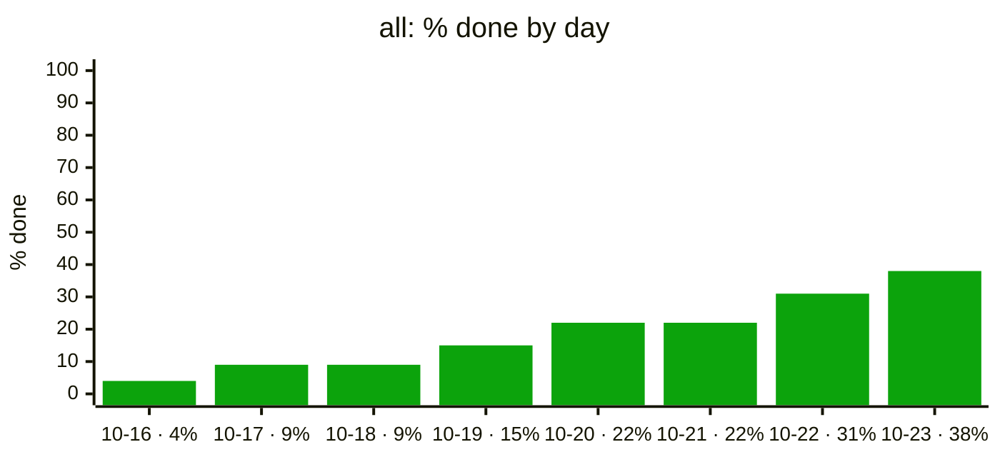
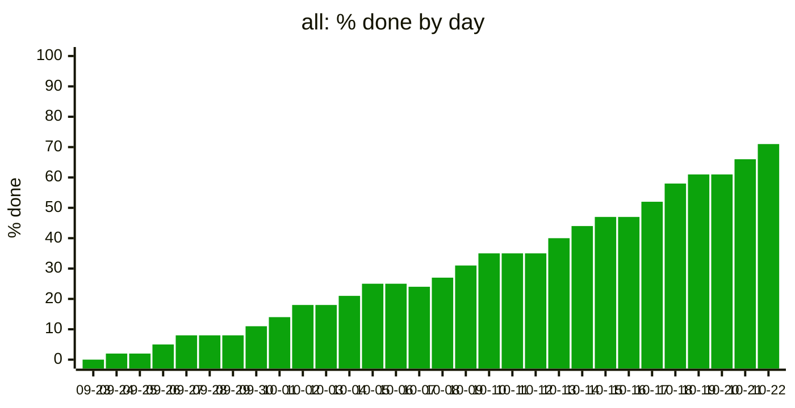

# Trend sample

Made-up data, to check how the trend chart in `progress/` looks once a
project has some history. Generated by `examples/trend_sample.py` with
`pmtrack.trend()`.

## Eight days

Up to ten days, each label also carries the value.

## Thirty days

Past ten days, labels are dates only; read values off the axis.

## One day

With a single day of history the review shows this note instead:

_The trend starts once there are two days of history._
