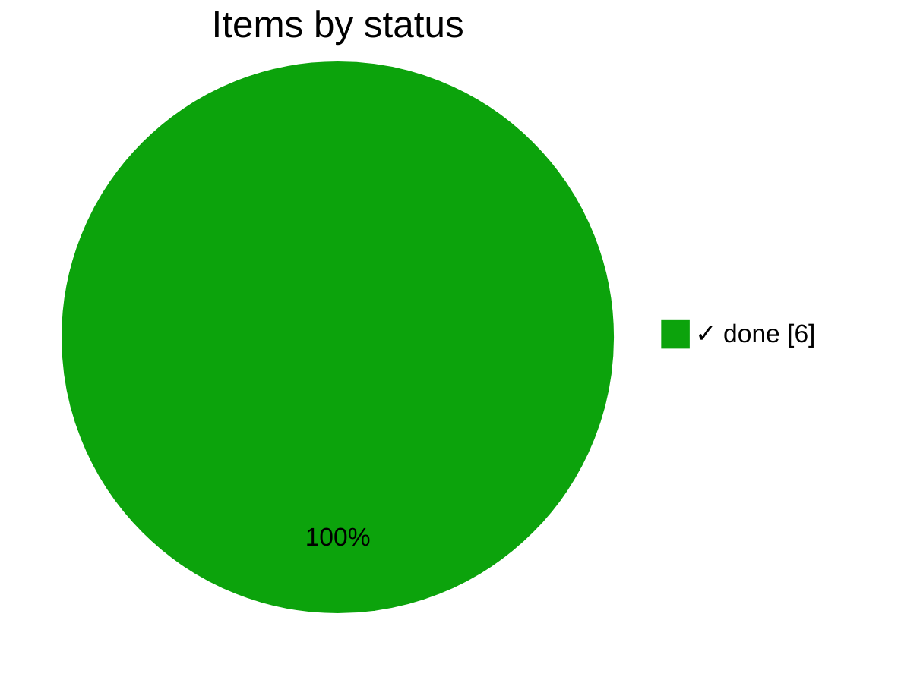
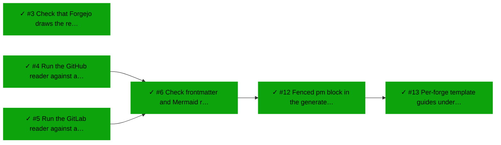

# ✓ Forges

_Plan `forges` · [doc](https://forgejo.lab.bvraghav.com/pm-bot/pmtrack/src/branch/develop/docs/forges.md) · data as of 2026-10-23 04:38 UTC · [all subsets](README.md)_

**100% done** · ✓ 6 done · ▶ 0 active · ○ 0 ready · ✕ 0 blocked

| Item | Status | Ticked | Depends on |
|---|---|--:|---|
| [#12](https://forgejo.lab.bvraghav.com/pm-bot/pmtrack/issues/12) Fenced pm block in the generated issue template | ✓ done | 3/3 | ✓ #6 |
| [#13](https://forgejo.lab.bvraghav.com/pm-bot/pmtrack/issues/13) Per-forge template guides under docs/templates | ✓ done | 3/3 | ✓ #12 |
| [#3](https://forgejo.lab.bvraghav.com/pm-bot/pmtrack/issues/3) Check that Forgejo draws the review charts | ✓ done | 3/4 |  |
| [#4](https://forgejo.lab.bvraghav.com/pm-bot/pmtrack/issues/4) Run the GitHub reader against a live repo | ✓ done | 2/2 |  |
| [#5](https://forgejo.lab.bvraghav.com/pm-bot/pmtrack/issues/5) Run the GitLab reader against a live project | ✓ done | 2/2 |  |
| [#6](https://forgejo.lab.bvraghav.com/pm-bot/pmtrack/issues/6) Check frontmatter and Mermaid rendering on GitHub and GitLab | ✓ done | 2/2 | ✓ #4, ✓ #5 |

## Changes

From 2026-10-22 20:30 to 2026-10-23 04:38 UTC:

- ✓ done: [#3](https://forgejo.lab.bvraghav.com/pm-bot/pmtrack/issues/3) Check that Forgejo draws the review charts
- ✓ done: [#4](https://forgejo.lab.bvraghav.com/pm-bot/pmtrack/issues/4) Run the GitHub reader against a live repo
- ✓ done: [#5](https://forgejo.lab.bvraghav.com/pm-bot/pmtrack/issues/5) Run the GitLab reader against a live project
- ✓ done: [#6](https://forgejo.lab.bvraghav.com/pm-bot/pmtrack/issues/6) Check frontmatter and Mermaid rendering on GitHub and GitLab
- new (done): [#12](https://forgejo.lab.bvraghav.com/pm-bot/pmtrack/issues/12) Fenced pm block in the generated issue template
- new (done): [#13](https://forgejo.lab.bvraghav.com/pm-bot/pmtrack/issues/13) Per-forge template guides under docs/templates

## Needs attention

Nothing blocked, stale or malformed.

## Next up

Nothing ready to start.

## Dependency graph

_Legend: ✓ done · ▶ active (assigned or partly ticked) · ○ ready (nothing it waits on is open) · ✕ blocked · arrows point from a dependency to what waits on it; dotted lines join a plan to its items._

## Trend

```mermaid
%%{init: {"themeVariables": {"xyChart": {"backgroundColor": "#ffffff", "titleColor": "#222222", "plotColorPalette": "#0ca30c,#ffffff,#d03b3b,#ffffff,#898781,#2a78d6", "xAxisLabelColor": "#222222", "xAxisTitleColor": "#222222", "xAxisTickColor": "#222222", "xAxisLineColor": "#222222", "yAxisLabelColor": "#222222", "yAxisTitleColor": "#222222", "yAxisTickColor": "#222222", "yAxisLineColor": "#222222"}}, "xyChart": {"height": 360}}}%%
xychart-beta
  title "plan:forges: items done and scope"
  x-axis ["10-22 · 1/4", "10-23 · 6/6"]
  y-axis "items" 0 --> 8
  bar [0, 5]
  bar [0, 0]
  bar [0, 0]
  bar [0, 0]
  line [4, 6]
  line [1, 6]
```

_Grey line: items in scope. Blue line: items done, weighted, with partial credit for ticked boxes. Green bars: items done that day. Red bars below 0: items done that were lost that day (reopened, or boxes unticked). A step up in the grey line means scope grew._
