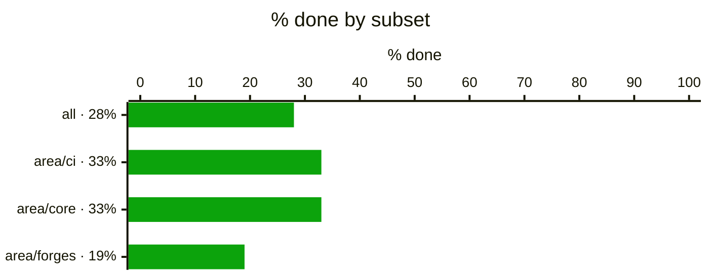
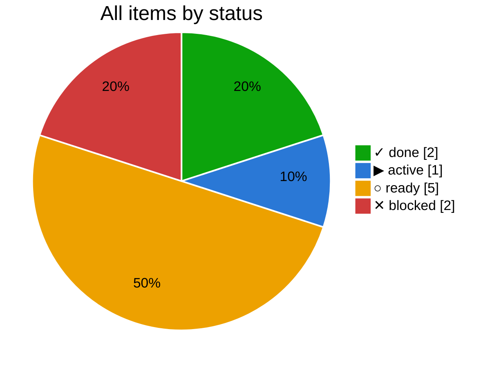
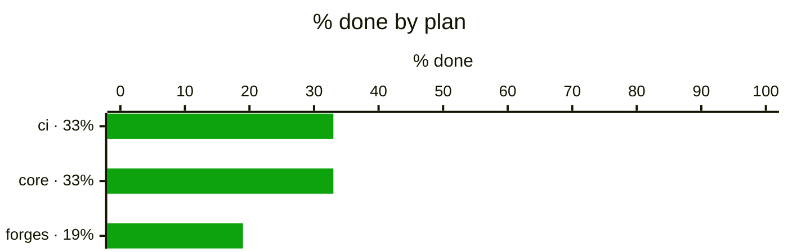
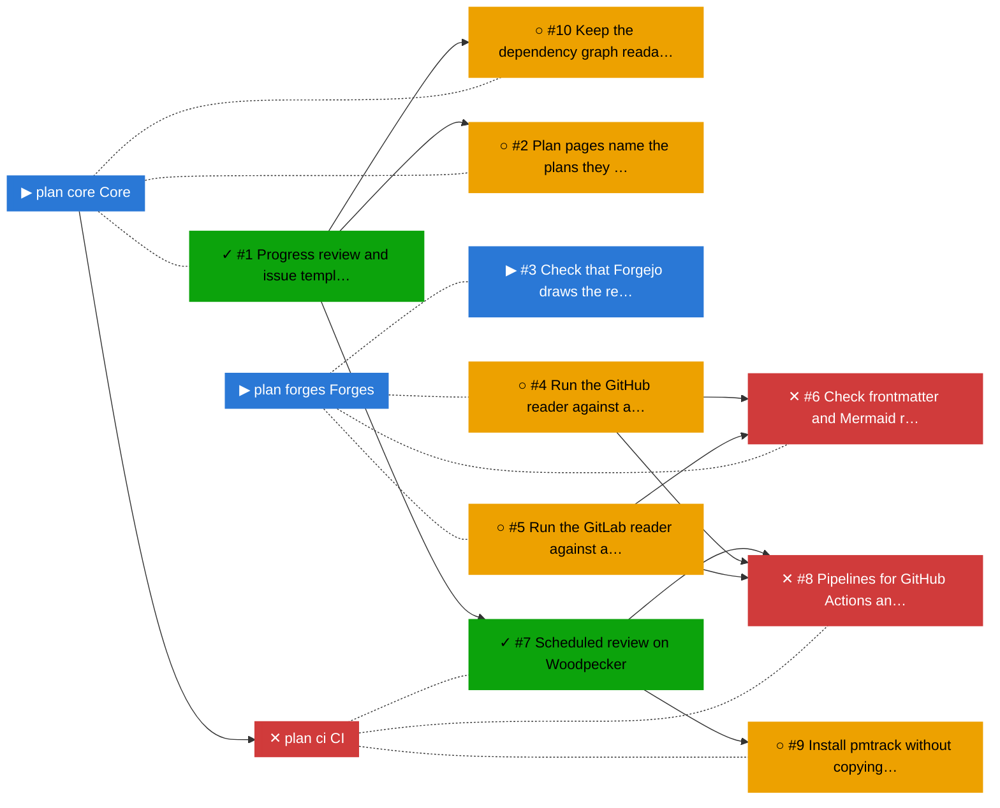

# Progress review

_Data as of 2026-10-22 20:50 UTC · changes compared with 2026-10-22 · generated by pmtrack 0.1.0_

| Subset | % done | ✓ done | ▶ active | ○ ready | ✕ blocked | Δ % pts |
|---|--:|--:|--:|--:|--:|--:|
| **all** | 28 | 2 | 1 | 5 | 2 | +17 |
| area/ci | 33 | 1 | 0 | 1 | 1 | +33 |
| area/core | 33 | 1 | 0 | 2 | 0 | -17 |
| area/forges | 19 | 0 | 1 | 2 | 1 | +19 |

## Plans

| Plan | % done | ✓ | ▶ | ○ | ✕ | Review |
|---|--:|--:|--:|--:|--:|---|
| ✕ [CI](../docs/ci.md) | 33 | 1 | 0 | 1 | 1 | [ci.md](ci.md) |
| ▶ [Core](../docs/core.md) | 33 | 1 | 0 | 2 | 0 | [core.md](core.md) |
| ▶ [Forges](../docs/forges.md) | 19 | 0 | 1 | 2 | 1 | [forges.md](forges.md) |

## Changes

From 2026-10-22 20:30 to 2026-10-22 20:50 UTC:

- ✓ done: [#7](https://forgejo.lab.bvraghav.com/pm-bot/pmtrack/issues/7) Scheduled review on Woodpecker
- ready → active: [#3](https://forgejo.lab.bvraghav.com/pm-bot/pmtrack/issues/3) Check that Forgejo draws the review charts
- blocked → ready: [#9](https://forgejo.lab.bvraghav.com/pm-bot/pmtrack/issues/9) Install pmtrack without copying the file
- new (ready): [#10](https://forgejo.lab.bvraghav.com/pm-bot/pmtrack/issues/10) Keep the dependency graph readable with many items

## Needs attention

### ✕ Blocked

- [#6](https://forgejo.lab.bvraghav.com/pm-bot/pmtrack/issues/6) Check frontmatter and Mermaid rendering on GitHub and GitLab, waiting on ○ [#4](https://forgejo.lab.bvraghav.com/pm-bot/pmtrack/issues/4) Run the GitHub reader against a live repo, ○ [#5](https://forgejo.lab.bvraghav.com/pm-bot/pmtrack/issues/5) Run the GitLab reader against a live project
- [#8](https://forgejo.lab.bvraghav.com/pm-bot/pmtrack/issues/8) Pipelines for GitHub Actions and GitLab CI, waiting on ○ [#4](https://forgejo.lab.bvraghav.com/pm-bot/pmtrack/issues/4) Run the GitHub reader against a live repo, ○ [#5](https://forgejo.lab.bvraghav.com/pm-bot/pmtrack/issues/5) Run the GitLab reader against a live project

## Next up

_Ready items, those that unblock the most first._

- ○ [#4](https://forgejo.lab.bvraghav.com/pm-bot/pmtrack/issues/4) Run the GitHub reader against a live repo (unblocks 2)
- ○ [#5](https://forgejo.lab.bvraghav.com/pm-bot/pmtrack/issues/5) Run the GitLab reader against a live project (unblocks 2)
- ○ [#10](https://forgejo.lab.bvraghav.com/pm-bot/pmtrack/issues/10) Keep the dependency graph readable with many items
- ○ [#2](https://forgejo.lab.bvraghav.com/pm-bot/pmtrack/issues/2) Plan pages name the plans they wait on
- ○ [#9](https://forgejo.lab.bvraghav.com/pm-bot/pmtrack/issues/9) Install pmtrack without copying the file

## Dependency graph

_Legend: ✓ done · ▶ active (assigned or partly ticked) · ○ ready (nothing it waits on is open) · ✕ blocked · arrows point from a dependency to what waits on it; dotted lines join a plan to its items._

## Trend

_The trend starts once there are two days of history._
