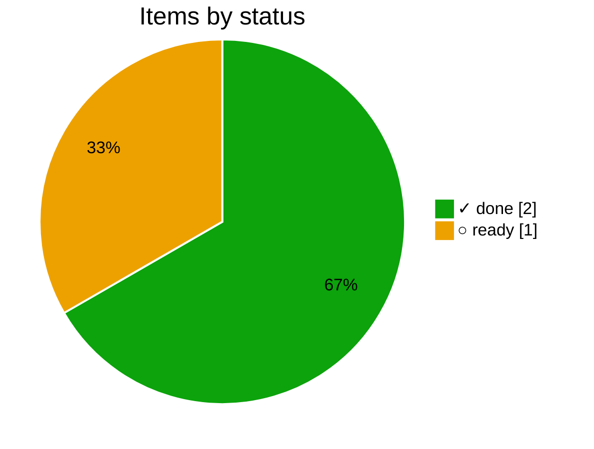
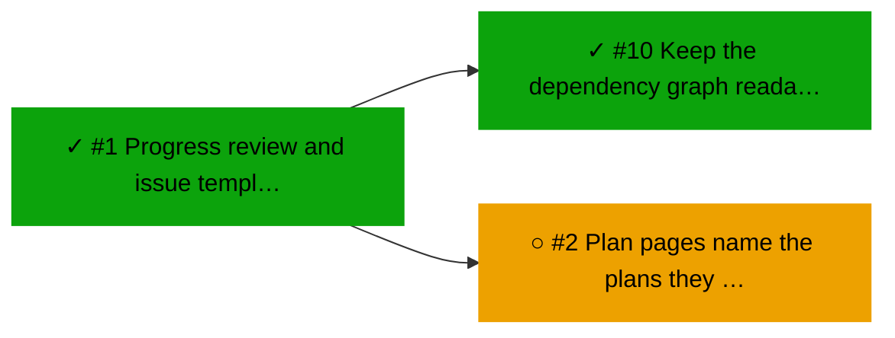

# ▶ Core

_Plan `core` · [doc](../docs/core.md) · data as of 2026-10-22 21:14 UTC · [all subsets](README.md)_

**67% done** · ✓ 2 done · ▶ 0 active · ○ 1 ready · ✕ 0 blocked

| Item | Status | Ticked | Depends on |
|---|---|--:|---|
| [#1](https://forgejo.lab.bvraghav.com/pm-bot/pmtrack/issues/1) Progress review and issue template generator | ✓ done | 2/2 |  |
| [#10](https://forgejo.lab.bvraghav.com/pm-bot/pmtrack/issues/10) Keep the dependency graph readable with many items | ✓ done | 2/2 | ✓ #1 |
| [#2](https://forgejo.lab.bvraghav.com/pm-bot/pmtrack/issues/2) Plan pages name the plans they wait on | ○ ready | 0/2 | ✓ #1 |

## Changes

From 2026-10-22 20:30 to 2026-10-22 21:14 UTC:

- new (done): [#10](https://forgejo.lab.bvraghav.com/pm-bot/pmtrack/issues/10) Keep the dependency graph readable with many items

## Needs attention

Nothing blocked, stale or malformed.

## Next up

- ○ [#2](https://forgejo.lab.bvraghav.com/pm-bot/pmtrack/issues/2) Plan pages name the plans they wait on

## Dependency graph

_Legend: ✓ done · ▶ active (assigned or partly ticked) · ○ ready (nothing it waits on is open) · ✕ blocked · arrows point from a dependency to what waits on it; dotted lines join a plan to its items._

## Trend

_The trend starts once there are two days of history._
