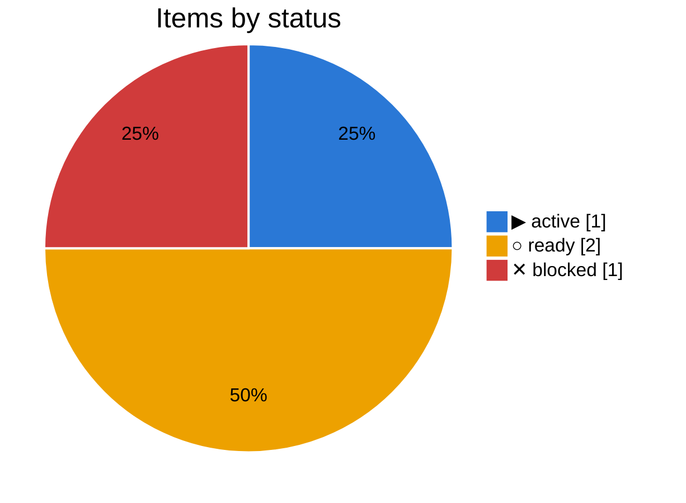
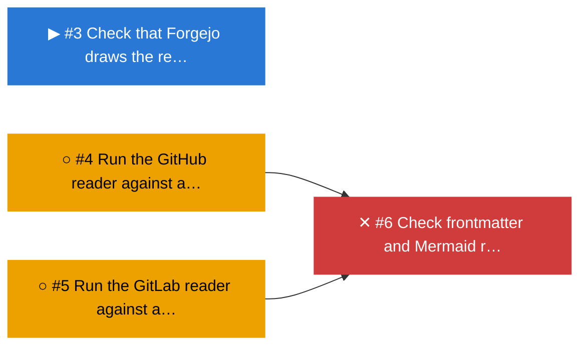

# ▶ Forges

_Plan `forges` · [doc](../docs/forges.md) · data as of 2026-10-22 20:50 UTC · [all subsets](README.md)_

**19% done** · ✓ 0 done · ▶ 1 active · ○ 2 ready · ✕ 1 blocked

| Item | Status | Ticked | Depends on |
|---|---|--:|---|
| [#3](https://forgejo.lab.bvraghav.com/pm-bot/pmtrack/issues/3) Check that Forgejo draws the review charts | ▶ active | 3/4 |  |
| [#4](https://forgejo.lab.bvraghav.com/pm-bot/pmtrack/issues/4) Run the GitHub reader against a live repo | ○ ready | 0/2 |  |
| [#5](https://forgejo.lab.bvraghav.com/pm-bot/pmtrack/issues/5) Run the GitLab reader against a live project | ○ ready | 0/2 |  |
| [#6](https://forgejo.lab.bvraghav.com/pm-bot/pmtrack/issues/6) Check frontmatter and Mermaid rendering on GitHub and GitLab | ✕ blocked | 0/2 | ○ #4, ○ #5 |

## Changes

From 2026-10-22 20:30 to 2026-10-22 20:50 UTC:

- ready → active: [#3](https://forgejo.lab.bvraghav.com/pm-bot/pmtrack/issues/3) Check that Forgejo draws the review charts

## Needs attention

### ✕ Blocked

- [#6](https://forgejo.lab.bvraghav.com/pm-bot/pmtrack/issues/6) Check frontmatter and Mermaid rendering on GitHub and GitLab, waiting on ○ [#4](https://forgejo.lab.bvraghav.com/pm-bot/pmtrack/issues/4) Run the GitHub reader against a live repo, ○ [#5](https://forgejo.lab.bvraghav.com/pm-bot/pmtrack/issues/5) Run the GitLab reader against a live project

## Next up

- ○ [#4](https://forgejo.lab.bvraghav.com/pm-bot/pmtrack/issues/4) Run the GitHub reader against a live repo (unblocks 2)
- ○ [#5](https://forgejo.lab.bvraghav.com/pm-bot/pmtrack/issues/5) Run the GitLab reader against a live project (unblocks 2)

## Dependency graph

_Legend: ✓ done · ▶ active (assigned or partly ticked) · ○ ready (nothing it waits on is open) · ✕ blocked · arrows point from a dependency to what waits on it; dotted lines join a plan to its items._

## Trend

_The trend starts once there are two days of history._
